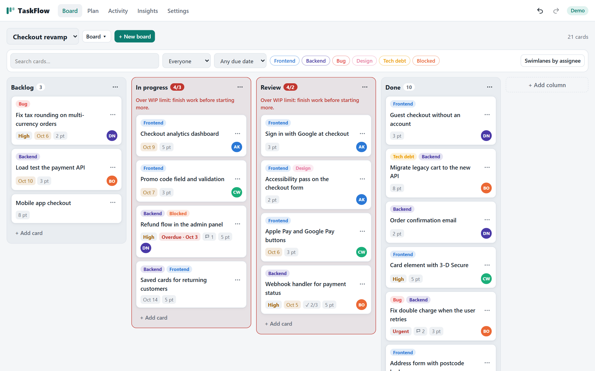
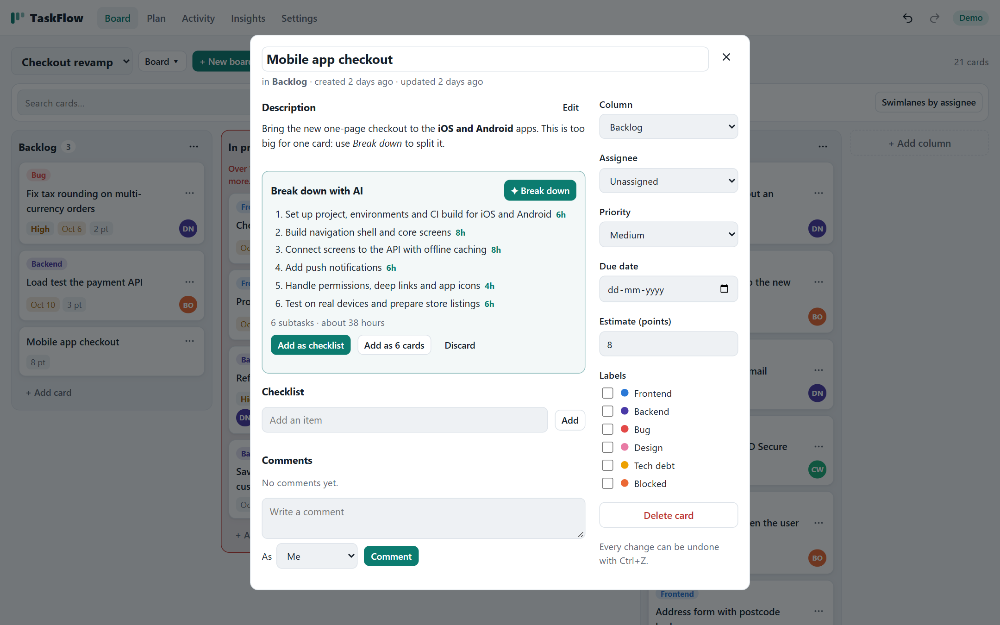
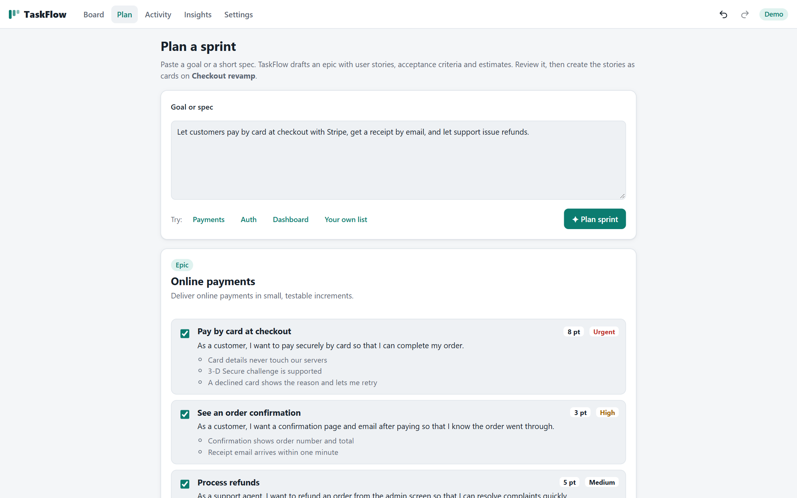
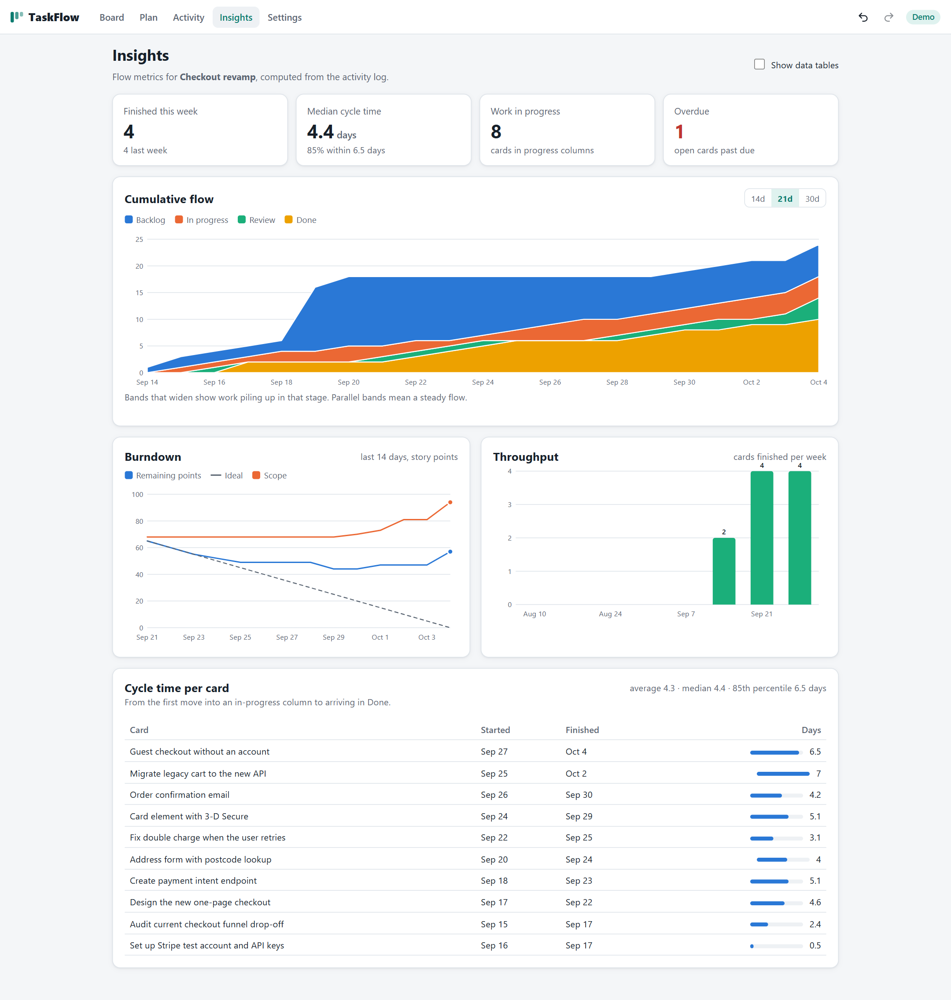
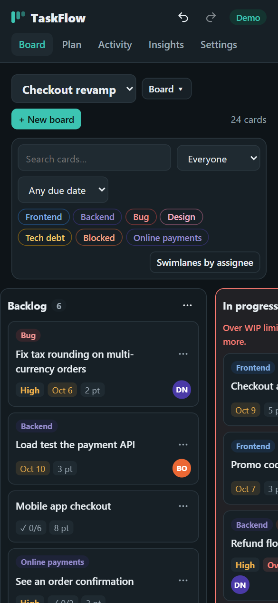
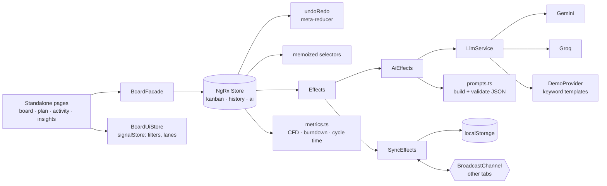

# TaskFlow


A Kanban project board built on NgRx, with AI task planning. Drag cards between columns, set WIP limits, filter and group by assignee, and undo anything. Ask the AI to break a big card into estimated subtasks, turn a goal into an epic with user stories and acceptance criteria, or write the daily standup from the board's activity log. An Insights page draws a cumulative flow diagram, a burndown, throughput and per-card cycle time, all computed from that log.

**[▶ Live demo](https://konicamaheshwarii.github.io/taskflow-ai/)**: opens on a seeded demo board in Demo mode. No key or sign-up needed.



## Features

- **Kanban boards.** Multiple boards with columns, WIP limits (amber at the limit, red when over) and a stage per column (not started, in progress, done).
- **Rich cards.** Title, Markdown description (rendered by an escaping renderer), labels, assignee, due date, priority, story points, checklist and comments.
- **Drag and drop** of cards between columns and of columns themselves, using `@angular/cdk/drag-drop`. Drops work in filtered views too.
- **Keyboard moves.** Every card and column has an accessible menu (`@angular/cdk/menu`): move to column, move up or down, move a column left or right. Moves are announced to screen readers.
- **Undo / redo** for every board change (Ctrl+Z, Ctrl+Shift+Z or Ctrl+Y, or the header buttons).
- **Filters and swimlanes.** Search, labels, assignee, due date (overdue, due this week, none), and a swimlane view by assignee where dragging into another lane reassigns the card.
- **Live sync across tabs.** Open the app in two tabs and changes appear in both (BroadcastChannel). Everything is saved in localStorage.
- **AI: Break down.** Turns a card's goal into 4-8 subtasks with hour estimates. Add them as a checklist or as new cards.
- **AI: Plan a sprint.** Paste a goal or spec and get an epic with user stories, acceptance criteria, points and priorities. Preview, untick what you don't want, then create the cards.
- **AI: Standup summary.** Done, in progress and blockers for the last day, three days or week, written from the activity log, overdue cards and WIP alerts.
- **Insights.** Cumulative flow, burndown with ideal and scope lines, weekly throughput and cycle time per card, as hand-written SVG charts with hover tooltips and optional data tables.
- **Bring your own key** for Google Gemini or Groq (both have free tiers). Keys stay in your browser and go straight to the provider; there is no backend.
- **Offline Demo mode** (the default): keyword templates for auth, payments, dashboards, landing pages, APIs, mobile apps, migrations, search and notifications, plus rule-based standups. Demo output goes through the same JSON validation as real model replies.
- **Light and dark themes**, responsive down to 390px.

| AI breakdown | Sprint planning |
|---|---|
|  |  |

| Insights | Mobile, dark |
|---|---|
|  |  |

## Architecture



- **NgRx for shared state.** Boards, columns, cards, labels and members are `@ngrx/entity` collections in one `kanban` feature built with `createFeature`. Actions are grouped with `createActionGroup`, and every mutation carries its own timestamp and id so reducers stay pure. Runtime immutability checks are on, and Redux DevTools are connected (`provideStoreDevtools`).
- **Signals for local UI state.** Filters and the swimlane toggle live in an `@ngrx/signals` `signalStore`, because they belong to one tab and should not be synced, persisted with the board, or undone.
- **Memoized selectors.** `selectBoardView` only recomputes when the active board, its columns or the card entities change; the component then narrows it with the filter signal.
- **Undo/redo as a meta-reducer.** It snapshots the `kanban` slice before each board action. Immutable state makes snapshots cheap (structural sharing). Selection, AI actions and remote changes are not recorded, and history is capped at 50 steps.
- **Activity log as the source of truth for metrics.** Each create, move and delete is logged with the column's stage at the time. Cycle time, cumulative flow, burndown and throughput are pure functions of that log, so they work for past days and survive column renames.
- **Tab sync without echo.** `SyncEffects` saves and broadcasts only after local board actions. Incoming state is applied as `Remote State Received`, which is never re-broadcast and keeps each tab on the board it is viewing.
- **Defensive AI output handling.** Code fences, surrounding prose and `<think>` blocks are stripped. Subtasks are de-duplicated and hours clamped, story points snap to the Fibonacci scale, unknown priorities fall back to medium, and empty results raise clear errors. User text is fenced in tags and treated as data.
- **Safe Markdown.** The renderer escapes all input first and only emits a fixed set of tags; links are limited to http(s) and mailto. Angular's sanitizer runs on top.
- **Zoneless, OnPush, lazy routes, hash routing** for GitHub Pages. About 102 kB initial transfer.

```
src/app
├── core
│   ├── state/          actions, reducer, selectors, undo-redo, effects, facade, persistence + tab sync
│   ├── ai/             prompts + validation, demo planner, standup input builder
│   ├── llm/            provider interface, Gemini, Groq, Demo, SSE reader
│   ├── board-rules.ts  WIP, filters, swimlanes, drop-index mapping
│   ├── board-ui.store.ts  signalStore for filters and layout
│   ├── metrics.ts      cycle time, cumulative flow, burndown, throughput
│   ├── markdown.ts     escaping Markdown renderer
│   └── seed.ts         demo workspace with three weeks of history
├── features/           board (+ card tile, card dialog) · plan · activity · insights (+ SVG charts) · settings
└── shared/             formatting helpers, autofocus directive
```

## Getting started

```bash
npm install
npm start          # http://localhost:4200
npm run test:ci    # unit tests in headless Chrome
npm run build
```

Open **Settings** to switch from Demo to Gemini or Groq and paste a free key:
[Gemini](https://aistudio.google.com/apikey) · [Groq](https://console.groq.com/keys). Settings also lets you manage team members and labels, and restore the demo workspace.

Install the [Redux DevTools](https://github.com/reduxjs/redux-devtools) browser extension to inspect actions, state and time-travel.

## Testing

52 unit tests cover the logic most likely to break:

- **Reducers**: card add/move/reorder, activity logging, no-op updates, column and board deletion, label and member removal, remote state merging.
- **Selectors**: board view ordering, WIP status and memoization.
- **Effects** with a mocked LLM: breakdown, sprint and standup success paths, invalid JSON and provider errors, persistence and broadcasting without echo.
- **Undo/redo meta-reducer**: undo, redo, redo-stack clearing, what is not recorded, the history cap.
- **WIP rules, filters, drop-index mapping and swimlanes**, plus the filter `signalStore`.
- **Metrics**: cycle time, cumulative flow, burndown and weekly throughput on a scripted history.
- **AI**: JSON extraction and validation, prompt fencing, the demo breakdown and sprint planners, the rule-based standup, and the seeded workspace.
- **Markdown** escaping and link filtering, SSE parsing and provider error messages.

CI (GitHub Actions) runs the tests and the production build on every push, then deploys `main` to GitHub Pages.

## License

[MIT](LICENSE)
